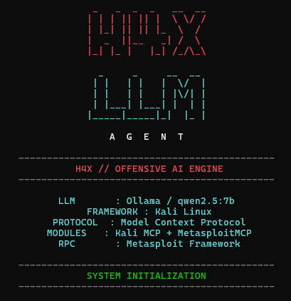
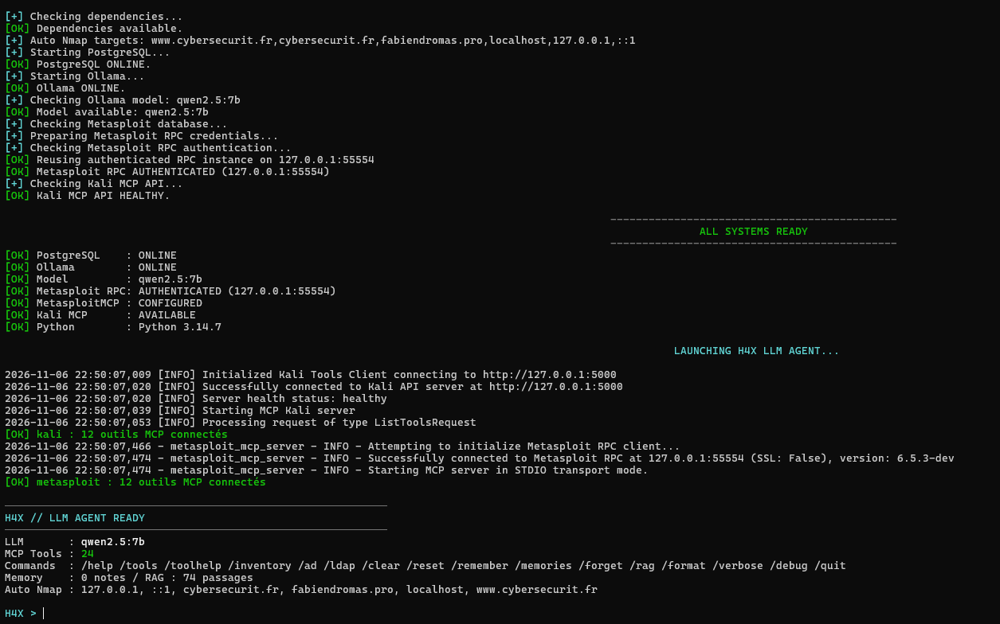
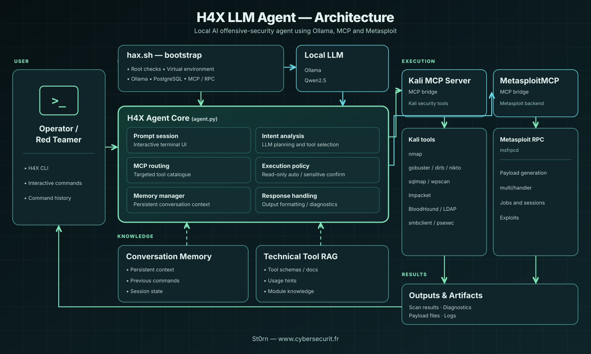

<div align="center">




### <code>H4X // OFFENSIVE AI ENGINE</code>

**Your local AI-powered interface to Kali Linux, MCP and Metasploit.**  
**Ton interface IA locale pour Kali Linux, MCP et Metasploit.**

[](LICENSE)


**[English](#english) · [Français](#français) · [Quick start](#quick-start) · [Security](SECURITY.md) · [MIT License](LICENSE)**

<sub>Developed by <a href="https://github.com/St0rn">St0rn</a> · <a href="https://www.cybersecurit.fr">Cybersecur'IT</a></sub>

</div>

---

> [!IMPORTANT]
> **EN:** Designed for authorized security assessments and isolated labs. Tool calls and interpretations require operator verification.  
> **FR :** Projet destiné aux audits autorisés et aux laboratoires isolés. Les commandes et leurs interprétations doivent être vérifiées par l'opérateur.

## H4X in action · H4X en action

<div align="center">



*Real Kali Linux startup · Démarrage réel sur Kali Linux*

</div>

---

## Architecture · Architecture de l'agent

<div align="center">



*EN: H4X control plane, local LLM, MCP execution bridges and feedback loop.*  
*FR : cœur H4X, LLM local, passerelles d'exécution MCP et retour des résultats vers l'opérateur.*

</div>

The operator interacts with `agent.py` through the H4X CLI. `hax.sh` prepares the runtime; Ollama/Qwen handles local model inference; tool routing connects Kali MCP and MetasploitMCP while operator approval protects sensitive execution. Conversation memory and technical RAG support the agent.

L'opérateur pilote `agent.py` depuis le terminal H4X. `hax.sh` prépare les services ; Ollama/Qwen assure l'inférence locale ; le routage d'outils relie Kali MCP et MetasploitMCP, avec validation humaine pour les actions sensibles. La mémoire conversationnelle et le RAG technique complètent l'agent.

---

## RPC handler compatibility / Compatibilité RPC du handler

| English | Français |
|:--|:--|
| Older Kali MetasploitMCP can forward an entire payload object into `pymetasploit3`. Implicit non-scalar defaults such as `AutoLoadExtensions` can then cause an RPC validation error. | Certaines versions de MetasploitMCP transmettent l'objet payload complet à `pymetasploit3`. Les options implicites non scalaires comme `AutoLoadExtensions` peuvent alors provoquer une erreur RPC. |
| v0.1.3 validates explicit x64 architecture requests for both payload generation and listener setup. | La v0.1.3 vérifie l'architecture x64 des demandes de génération et de lancement de listener. |
| An **optional, reversible** system patch avoids forwarding default payload options for `exploit/multi/handler` only. | Un correctif système **optionnel et réversible** évite l'envoi des options implicites du payload pour `exploit/multi/handler` uniquement. |

<details>
<summary><strong>Apply on Kali / Appliquer sur Kali</strong></summary>

```bash
# Inspect package compatibility / Vérifier la compatibilité
sudo python3 tools/patch_metasploitmcp_handler.py --check

# Apply once (creates a backup) / Appliquer une fois (crée une sauvegarde)
sudo python3 tools/patch_metasploitmcp_handler.py --apply

# Restart H4X / Redémarrer H4X
sudo bash ./hax.sh
```

For a rollback, use `--restore /path/to/MetasploitMCP.py.bak-...`.
Pour revenir en arrière, utilise `--restore /chemin/vers/MetasploitMCP.py.bak-...`.

</details>

> [!WARNING]
> **EN:** Changes to the Kali-packaged system file can be overwritten by package upgrades. This patch is signature-checked, creates a backup and preserves operator confirmation. No live RPC success is claimed.  
> **FR :** Une mise à jour du paquet Kali peut écraser ce correctif. Le script vérifie la signature du code, sauvegarde l'original et conserve la confirmation utilisateur. Son fonctionnement réel sur Kali reste à valider.

---

## MCP discovery workflow · Découverte des outils MCP

| **EN — v0.1.2** | **FR — v0.1.2** |
|:--|:--|
| Read-only catalogues (`list_payloads`, `list_jobs`) no longer require confirmation. | Les catalogues en lecture seule (`list_payloads`, `list_jobs`) ne nécessitent plus de confirmation. |
| H4X offers a smaller, intent-relevant tool list to Ollama. | H4X fournit à Ollama une liste d'outils ciblée selon la demande. |
| The full MCP result remains visible; a relevance-ranked excerpt goes into the model context. | La sortie MCP complète reste visible ; un extrait pertinent est envoyé au modèle. |
| **100 results may be a partial catalogue**, not evidence of module absence. | **100 résultats peuvent être une liste partielle**, pas une preuve d'absence. |
| Explicit x64 requests retain architecture checks; execution still requires approval. | Les contrôles x64 restent actifs et l'exécution nécessite toujours une validation. |

> [!NOTE]
> **EN:** This release improves the agent's decision flow. It does not fix the upstream Metasploit RPC generation error.  
> **FR :** Cette version améliore la logique de décision de l'agent. Elle ne corrige pas l'erreur RPC interne de génération Metasploit.

---

## At a glance · En un coup d'œil

| <div align="center">LOCAL AI</div> | <div align="center">MCP BRIDGE</div> | <div align="center">TECHNICAL RAG</div> |
|:---:|:---:|:---:|
| **Ollama + Qwen** | **Kali MCP + MetasploitMCP** | **Tool schemas + local documentation** |
| Private inference | 24 MCP tools in the pictured setup | Searchable technical knowledge |

| <div align="center">ACTIVE DIRECTORY</div> | <div align="center">OPERATOR CONTROL</div> | <div align="center">TERMINAL UX</div> |
|:---:|:---:|:---:|
| **AD · DNS · LDAP · SMB** | **Scoped targets + confirmations** | **Rich · History · Markdown** |
| Bounded discovery | Authorized workflow | Interactive CLI |

---

<a id="english"></a>
## English

### What is H4X?

**H4X LLM Agent** is an experimental, terminal-first security assistant that combines a locally hosted language model with the tool interfaces of Kali Linux and Metasploit. It discovers the actual MCP capabilities available in your environment, searches technical references when needed, and presents tool results in a structured terminal workflow.

It is **operator-assisted** software—not a substitute for a validated penetration-testing methodology.

<details open>
<summary><strong>Core capabilities</strong></summary>

| Capability | Implementation |
|:--|:--|
| Local intelligence | Ollama and a locally configured model (example: Qwen 2.5 7B) |
| Tool orchestration | Dynamic discovery of Kali MCP and MetasploitMCP tool schemas |
| Tool-aware Nmap requests | Recognizes explicit scan modes such as quick scans and aggressive scans |
| Technical knowledge | Lexical RAG over real MCP schemas, local help and text documents |
| Active Directory | Bounded reconnaissance helpers and LDAP discovery |
| Persistent operator context | Local notes and conversation state |
| Developer-friendly interface | Readable tool output, command preview, editable history |
| Execution policy | Confirm sensitive operations; scope permitted automation to explicit targets |

</details>

### How the pieces fit together

```text
                       H4X // LLM AGENT
                               |
          +--------------------+--------------------+
          |                    |                    |
          v                    v                    v
    OLLAMA / LLM       TECHNICAL RAG         LOCAL MEMORY
          |
          v
   INTENT + TOOL ROUTER
          |
          v
   OPERATOR AUTHORIZATION
          |
      +---+-------------------+
      |                       |
      v                       v
   KALI MCP              METASPLOIT MCP
      |                       |
      +-----------+-----------+
                  |
                  v
          REAL TOOL OUTPUT
                  |
                  v
          H4X INTERACTIVE CLI
```

<a id="quick-start"></a>
### Quick start

**01 — Prepare the environment.** Use a dedicated Kali VM with Python 3, Ollama, Kali MCP Server, MetasploitMCP and Metasploit Framework installed and configured. Confirm the server executable names for your Kali release.

**02 — Clone and install.**

```bash
git clone https://github.com/St0rn/H4X-LLM-Agent.git
cd H4X-LLM-Agent
python3 -m venv .venv
.venv/bin/python3 -m pip install -r requirements.txt
ollama pull qwen2.5:7b
```

**03 — Review the launcher and start.**

```bash
chmod +x hax.sh
sudo bash ./hax.sh
```

> [!WARNING]
> The launcher currently uses elevated privileges and starts/checks local services. Inspect the script before execution. Keep RPC credentials and secrets out of Git. The README does not imply that all integrations work unchanged across Kali releases.

<details>
<summary><strong>Command reference / Commandes disponibles</strong></summary>

| Command | Purpose |
|:--|:--|
| `/help` · `/tools` | Help and exposed MCP tools |
| `/inventory` | Available binaries and integrations |
| `/ad <target> [domain]` | Bounded Active Directory discovery |
| `/ldap <target> [baseDN]` | LDAP RootDSE and scoped queries |
| `/rag tools` | MCP knowledge inventory |
| `/rag build` | Generate / refresh local technical knowledge |
| `/rag search <query>` | Search indexed references |
| `/rag reload` | Reload documentation |
| `/toolhelp <binary>` | Index installed tool help |
| `/remember <note>` · `/memories` | Persistent notes |
| `/clear` · `/reset` · `/quit` | Clear display, context or exit |

</details>

<details>
<summary><strong>Technical RAG: scope and limitations</strong></summary>

The RAG knowledge store is **lexical**, built from MCP tool names, descriptions and input schemas, supplemented by local `--help` output and project documents. It does **not** automatically possess the full manuals for every Kali tool and is **not** an embedding-based semantic vector database.

```text
H4X > /rag tools
H4X > /rag build
H4X > /rag search nmap
H4X > /toolhelp nmap
```

</details>

<details>
<summary><strong>Safe target configuration</strong></summary>

To allow selected low-friction Nmap interactions on **explicitly authorized targets**, edit `H4X_AUTO_TARGETS` in `hax.sh` before starting the agent:

```bash
export H4X_AUTO_TARGETS="localhost,127.0.0.1,::1,lab.example"
```

Hostnames match exactly. Adding `lab.example` does not implicitly authorize `www.lab.example` or its subdomains. Sensitive operations continue to require human approval.

</details>

---

<a id="français"></a>
## Français

### Pourquoi H4X ?

**H4X LLM Agent** est un outil expérimental de cybersécurité en terminal. Il associe un LLM exécuté localement via Ollama aux serveurs **Kali MCP** et **MetasploitMCP** pour assister un opérateur dans la sélection des outils, l'exécution des commandes autorisées et l'exploitation de leurs résultats.

L'objectif est de conserver un workflow **local, contrôlable, traçable et extensible**.

<details open>
<summary><strong>Fonctionnalités principales</strong></summary>

| Module | Fonction |
|:--|:--|
| Intelligence locale | Ollama et modèle configurable, dont Qwen 2.5 7B |
| Outils Kali | Découverte dynamique des outils réellement exposés par Kali MCP |
| Metasploit | Connexion au serveur RPC via MetasploitMCP |
| Routage Nmap | Correspondance des demandes explicites et des options de scan |
| RAG technique | Index lexical des schémas MCP, aides locales et documents |
| Active Directory | Reconnaissance AD, DNS, LDAP et SMB bornée |
| Mémoire | Notes locales persistantes |
| Interface | Terminal Rich, historique éditable, aperçu de commandes |
| Contrôle d'exécution | Périmètre explicite et confirmation des appels sensibles |

</details>

### Installation

**01 — Préparer Kali.** Utilise une VM dédiée et installe Python 3, Ollama, Kali MCP Server, MetasploitMCP et Metasploit Framework. Vérifie leurs points d'entrée selon la version de Kali.

**02 — Installer les dépendances.**

```bash
git clone https://github.com/St0rn/H4X-LLM-Agent.git
cd H4X-LLM-Agent
python3 -m venv .venv
.venv/bin/python3 -m pip install -r requirements.txt
ollama pull qwen2.5:7b
```

**03 — Démarrer.**

```bash
chmod +x hax.sh
sudo bash ./hax.sh
```

> [!CAUTION]
> Le lanceur nécessite actuellement des privilèges élevés et gère plusieurs services locaux. Vérifie `hax.sh` avant exécution. Ne publie jamais les mots de passe RPC, journaux et données de session.

<details>
<summary><strong>Configuration des cibles Nmap autorisées</strong></summary>

Modifie `H4X_AUTO_TARGETS` dans `hax.sh` pour déclarer les seules cibles sur lesquelles l'exécution automatique est autorisée :

```bash
export H4X_AUTO_TARGETS="localhost,127.0.0.1,::1,lab.example"
```

Chaque nom est comparé exactement. Les opérations sensibles restent soumises à confirmation. L'autorisation contractuelle ou explicite du propriétaire reste obligatoire.

</details>

<details>
<summary><strong>Utilisation du RAG et mémoire</strong></summary>

```text
H4X > /rag build
H4X > /rag search kerberos
H4X > /toolhelp nmap
H4X > /remember Mon laboratoire utilise un réseau isolé
H4X > /memories
```

Le RAG interroge la documentation technique disponible localement. Il ne remplace pas la documentation officielle ni la vérification des sorties réelles.

</details>

<details>
<summary><strong>Limites connues</strong></summary>

- Les outils MCP disponibles dépendent de l'installation Kali et des versions des serveurs.
- Un modèle peut mal interpréter une demande ou proposer des arguments invalides.
- La recherche documentaire est lexicale, non vectorielle.
- Un aperçu de commande n'est pas une preuve d'exécution.
- Les captures d'écran sont authentiques, sans garantir le fonctionnement sur chaque machine.

</details>

---

## Repository / Dépôt

```text
H4X-LLM-Agent/
|-- agent.py                 # Interactive agent / Agent interactif
|-- hax.sh                   # Launcher / Lanceur
|-- ad_tools.py              # AD and LDAP helpers
|-- technical_rag.py         # Technical knowledge retrieval
|-- requirements.txt         # Dependencies / Dépendances
|-- docs/                    # Documentation
|-- tests/                   # Tests
|-- assets/screenshots/      # Authentic PNG screenshots / Captures réelles
|-- LICENSE                  # MIT License
`-- README.md                # EN / FR
```

<div align="center">

### Open source · MIT licensed

[Security / Sécurité](SECURITY.md) · [Contributing / Contribuer](CONTRIBUTING.md) · [Changelog](CHANGELOG.md) · [License / Licence](LICENSE)

<sub>© 2026 St0rn — <a href="https://www.cybersecurit.fr">www.cybersecurit.fr</a></sub>

**Think like an adversary. Operate with discipline.**  
*Penser comme l'adversaire. Agir avec méthode.*

</div>
